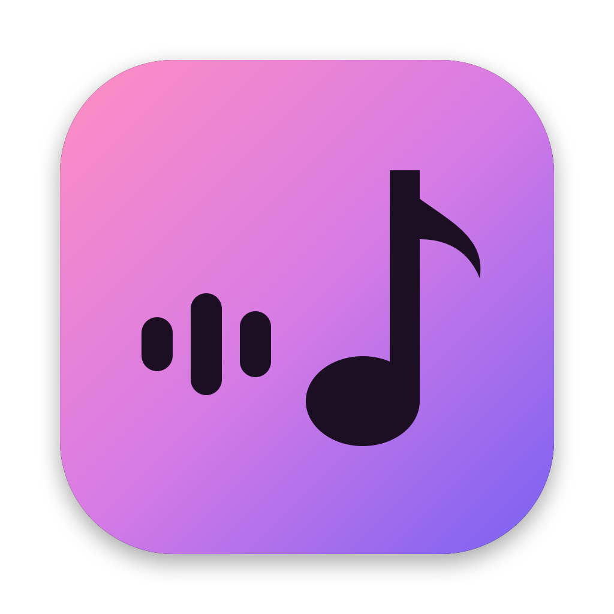
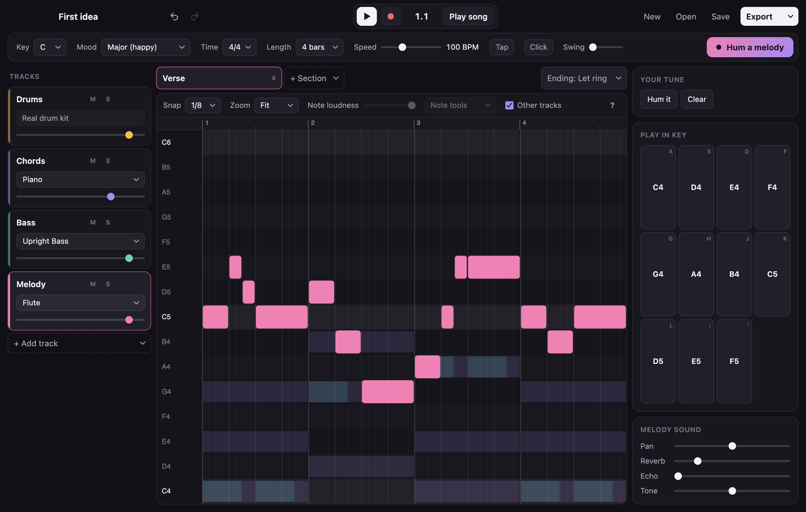

<p align="center">
  <a href="https://hollowbit.dev/melodyshaper/"></a>
</p>

<h1 align="center">Melodyshaper</h1>

<p align="center"><b>Hum a tune and hear it on a real instrument.</b></p>
<p align="center">A free music maker for beginners, for Mac and Windows.</p>

<p align="center">
  <a href="https://github.com/hollowbit-dev/melodyshaper/releases/latest"></a>
  
  
  <a href="LICENSE"></a>
</p>

<p align="center">
  <a href="https://hollowbit.dev/melodyshaper/"></a>
</p>

<p align="center"></p>

## What it does

- **Hum it.** Your voice becomes notes on piano, strings, flute, sax and more. This uses classic pitch detection, with no AI, and your voice stays on your computer.
- **Find my chords.** Melodyshaper offers three chord progressions that fit the notes you hummed.
- **Make a melody.** Get a new melody from your chords or bass line, written with fixed music rules, then edit it however you like.
- **Nothing sounds wrong.** Every note snaps to your key and every sound snaps to the beat.
- **Real instruments.** 43 recorded instruments, 29 drum sounds and 119 drum presets across styles from rock to samba.
- **Plug in a guitar.** Use a USB guitar cable or audio interface, with amp sounds, a tuner, and single notes turned into editable notes.
- **Whole songs.** Sections, up to 16 tracks, 4/4, 3/4, 6/8 and 5/4, swing, per-track pan, reverb, echo and tone, and a ring-out or fade-out ending.
- **Play it your way.** Hum a tune, beatbox a beat, record your voice, or play the computer keyboard, a MIDI keyboard or a MIDI guitar.
- **Nothing locked.** Save, reopen, and export MP3, WAV, stems or MIDI for free.

> Windows builds have not been tried on a real PC yet, and guitar and MIDI input have only been tested with simulated signals so far.

## Install

Get the installer from the [website](https://hollowbit.dev/melodyshaper/) or the [latest release](https://github.com/hollowbit-dev/melodyshaper/releases/latest).

- **Mac:** open the .dmg and drag Melodyshaper to Applications. The first time, right-click it and choose **Open**, because the app isn't signed yet.
- **Windows:** run the installer. If SmartScreen appears, click **More info**, then **Run anyway**.

## Develop

```sh
npm install
npm start
npm test
```

Instrument credits are in [SAMPLES.md](SAMPLES.md).

## More free apps from Hollowbit

- **[Clipshaper](https://hollowbit.dev/clipshaper/)**: long videos to short clips
- **[Captionshaper](https://hollowbit.dev/captionshaper/)**: offline auto subtitles
- **[Lightshaper](https://hollowbit.dev/lightshaper/)**: free photo editor
- **[Fileshaper](https://hollowbit.dev/fileshaper/)**: compress, convert, sign PDFs
- **[Writeshaper](https://hollowbit.dev/writeshaper/)**: offline writing assistant
- **[Moveshaper](https://hollowbit.dev/moveshaper/)**: move to a new computer
- **[Diskshaper](https://hollowbit.dev/diskshaper/)**: clean up storage
- **[Startshaper](https://hollowbit.dev/startshaper/)**: find out why your PC is slow
- **[Fuseduo](https://fuseduo.com/)**: automate your Mac apps

## Licence

The code is MIT licensed, and the recordings are CC0.

---

<p align="center"><sub>Made by <a href="https://hollowbit.dev">Hollowbit Studio</a>. If Melodyshaper helped you, a ⭐ helps other people find it.</sub></p>
